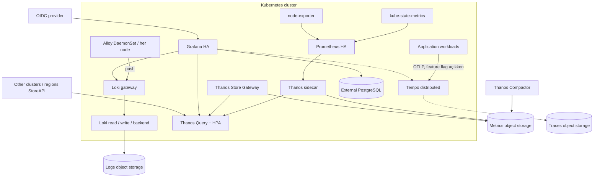

# obs-platform-infra

Kubernetes üzerinde cloud-agnostic, yüksek erişilebilir gözlemlenebilirlik kontrol düzlemi. Repo yalnızca platform IaC'sini içerir; uygulama dashboard'ları, tenant RBAC'i ve uygulama enstrümantasyonu ayrı repolarda yaşar.

## Mimari kararlar

Environment'lar Terraform workspace yerine klasörlerle ayrıldı. `dev`, `staging` ve `prod` bağımsız root module, state anahtarı, Helm values ve GitHub onay kapısına sahiptir. Bu tercih yanlış workspace üzerinde apply riskini azaltır, environment farklarını PR diff'inde görünür kılar ve state blast radius'unu sınırlar. Ortak davranış tek bir `observability-stack` modülünde tutulduğu için kopyalanmış platform mantığı oluşmaz.

```text
obs-platform-infra/
├── .github/workflows/       # PR plan ve onay kapılı main apply
├── environments/
│   ├── dev/                 # bağımsız root module + Kubernetes state
│   ├── staging/
│   └── prod/
│       └── values/          # chart bazında environment kapasite ayarları
├── modules/
│   └── observability-stack/ # namespace, secret, policy ve Helm release'leri
├── scripts/validate.sh
└── Makefile
```



### Neden bu bileşenler?

- **kube-prometheus-stack:** Operator CRD'leri, Kubernetes recording/alerting kuralları, node-exporter ve kube-state-metrics için aynı yaşam döngüsünü sağlar. Prometheus lokal retention `15d`; HA replica'ları aynı seriyi `prometheus_replica` etiketiyle üretir.
- **Thanos:** Sidecar yeni blokları object storage'a yükler; Store Gateway tarihsel blokları sunar; Compactor downsample/compact eder ve `395d` (13 ay) retention uygular. Query yerel sidecar'ı DNS ile, diğer cluster StoreAPI uçlarını `additional_thanos_store_endpoints` ile birleştirir ve replica deduplication yapar. Bitnami chart şablonu kullanılırken kaldırılmış Bitnami container'ı yerine digest ile sabitlenmiş resmi `thanosio/thanos` image'ı çalıştırılır.
- **Loki simple scalable:** Read, write ve backend ayrımı bağımsız kapasite yönetimi sağlar; mikroservis modunun operasyon maliyetine geçmeden yatay büyür. Alloy node-local dosyaları DaemonSet olarak okur ve Kubernetes metadata'sı ekler.
- **Tempo distributed:** `tempo_enabled` ile tamamen açılıp kapanır. Açıldığında OTLP gRPC/HTTP kabul eder, trace bloklarını aynı S3/GCS sözleşmesine yazar ve Grafana datasource otomatik oluşur.
- **Grafana HA:** En az iki replica ve PDB ile çalışır; kalıcı state harici PostgreSQL'dedir, pod diski stateless'tir. Generic OAuth üzerinden herhangi bir standart OIDC provider'a bağlanır.
- **NetworkPolicy:** Namespace varsayılan olarak ingress/egress kapalıdır. Aynı namespace trafiği, DNS, object-store/PostgreSQL, Kubernetes API ve control-plane scrape portları ile açıkça etiketlenmiş istemci namespace'leri izinlidir. İlerideki tenant repo'su erişecek namespace'e `observability.platform/access=allowed` etiketi ekler.

## Retention ve depolama sözleşmesi

| Veri | Uygulama retention | Depolama |
|---|---:|---|
| Prometheus TSDB | 15 gün | Cluster PVC |
| Thanos metrics | 395 gün | S3-compatible veya GCS |
| Loki logs | 365 gün | S3-compatible veya GCS |
| Tempo traces | 365 gün | S3-compatible veya GCS |

Loki object storage'a ilk günden yazar; “30 gün sıcak, 1 yıl soğuk” katmanı bucket lifecycle tarafından uygulanır. Logs bucket'ında nesneleri 30. günde S3 Glacier Instant Retrieval/GCS Coldline sınıfına geçirip 365. günde silen bir lifecycle kuralı zorunludur. Loki'nin kendi `8760h` retention ayarı da 365 günden eski indeks ve chunk'ları temizler. Object storage bucket'ları bu repo tarafından oluşturulmaz; merkezi data-platform/security hesabında encryption, versioning, public-access-block, audit logging ve immutability politikalarıyla önceden sağlanır.

Thanos Compactor tek writer olmalıdır. Aynı metrics bucket'ına bakan ikinci bir cluster'da Compactor açılmamalı; global kurulumda bir cluster compaction sahibi seçilmeli veya cluster başına ayrı bucket kullanılmalıdır. Bu modül varsayılan olarak kurulduğu cluster'da Compactor açar.

## Ön koşullar

- Kubernetes 1.30+ ve çalışan bir CSI StorageClass
- Terraform 1.8–1.13, Helm 3 ve cluster-admin olmayan fakat gerekli namespace/CRD kaynaklarını yönetebilen bir deploy kimliği
- Metrics, logs ve traces için üç bucket; server-side encryption ve versioning açık
- Grafana için yedeklemeli harici PostgreSQL 15+ veritabanı
- OIDC client; callback URL `https://<grafana-host>/login/generic_oauth`
- NetworkPolicy uygulayan bir CNI ve metrics-server (Thanos Query HPA için)

AWS'de statik key yerine IRSA, GKE'de Workload Identity Federation önerilir. İlgili annotation'lar `service_account_annotations` ile Prometheus/Thanos, Loki ve Tempo service account'larına uygulanır. `object_storage.access_key`, `secret_key` ve `gcs_service_account` alanları bu durumda boş bırakılabilir.

## Girdi sözleşmesi

Her environment root'u aşağıdaki değerleri güvenli bir `*.auto.tfvars.json` dosyasından veya GitHub secret'ından alır:

| Değişken | İçerik |
|---|---|
| `cluster_name`, `region` | Global metric/log etiketleri |
| `storage_class_name` | CSI class; verilmezse cluster default'u |
| `service_account_annotations` | IRSA/GKE/Azure workload identity annotation map'i |
| `object_storage` | `type` (`s3`/`gcs`), üç bucket ve isteğe bağlı endpoint/credential alanları |
| `postgres` | `host`, `port`, `database`, `username`, `password`, `ssl_mode` |
| `grafana_admin` | Break-glass kullanıcı ve güçlü parola |
| `oidc` | Client bilgileri, auth/token/userinfo URL'leri, scope ve rol JMESPath ifadesi |
| `grafana` | Host, ingress class, TLS secret ve ingress annotation'ları |
| `tempo_enabled` | Distributed tracing feature flag'i |
| `control_plane_scraping_enabled` | Self-managed cluster'larda scheduler/controller/etcd scrape; EKS/GKE/AKS için varsayılan `false` |
| `additional_thanos_store_endpoints` | Global Query'nin bağlanacağı gRPC StoreAPI adresleri |

Secret değerleri Terraform state'e girer. State Kubernetes backend ile `kube-system` namespace'inde environment başına ayrı Secret'ta tutulur. Cluster tarafında etcd encryption-at-rest ve bu Secret'lara yalnız CI deploy kimliğinin erişebildiği RBAC zorunludur.

## Kurulum

1. Hedef cluster kubeconfig context'ini doğrulayın ve `kube-system` içinde state Secret okuyup yazma yetkisini deploy kimliğine verin.
2. Seçilen environment altında git tarafından yok sayılan bir `runtime.auto.tfvars.json` oluşturun ve yukarıdaki sözleşmeyi gerçek endpoint/secret değerleriyle doldurun.
3. Bucket lifecycle ve harici PostgreSQL backup/PITR ayarlarını doğrulayın.
4. Çalıştırın:

```bash
make validate
make init ENVIRONMENT=dev
make plan ENVIRONMENT=dev
make apply ENVIRONMENT=dev
```

5. Sağlığı doğrulayın:

```bash
kubectl -n observability get pods,pdb,hpa
kubectl -n observability get prometheus,alertmanager,servicemonitor
kubectl -n observability port-forward svc/thanos-query 9090:9090
```

`/api/v1/query?query=up` üzerinden cluster label'larını, Grafana `/api/health` üzerinden database durumunu ve Loki `/ready` uçlarını kontrol edin. Tempo açıksa bir test OTLP span gönderip Grafana Explore'da trace ID ile sorgulayın.

## Çoklu cluster / bölge

Her cluster benzersiz `cluster_name` ve mümkünse ayrı metrics bucket kullanır. Merkezi query cluster'ında diğer Store Gateway veya Thanos Query gRPC adreslerini `additional_thanos_store_endpoints` listesine ekleyin. Adresler private DNS/mesh üzerinden erişilebilir olmalı ve ağ politikası/transport güvenliği platform ağ katmanında sağlanmalıdır. Query replica label üzerinden HA Prometheus örneklerini tekilleştirir; `cluster`, `region` ve `environment` etiketlerini korur.

## CI/CD

`terraform-pr.yaml` her PR'da format, init, validate ve üç environment için plan çalıştırır; her environment planını güncellenen tek bir PR yorumu olarak yayınlar. `terraform-apply.yaml`, `main` merge'inden sonra environment'ları seri uygular.

Repository secret'ları: `KUBECONFIG_DEV`, `KUBECONFIG_STAGING`, `KUBECONFIG_PROD` ve karşılık gelen `TFVARS_DEV`, `TFVARS_STAGING`, `TFVARS_PROD`. Kubeconfig düz YAML, TFVARS secret'ı geçerli JSON içermelidir. GitHub'da `apply-dev`, `apply-staging`, `apply-production` Environments oluşturulmalı ve her birine required reviewer kuralı eklenmelidir; bu kural main apply'ın manuel onay kapısıdır. Production environment yalnız korumalı `main` branch'inden deployment kabul etmelidir.

## Felaket kurtarma

RPO/RTO, üç kalıcı katmanın bağımsız geri dönüşüne dayanır:

1. **Terraform state:** Kubernetes backend Secret'larını etcd snapshot politikasına dahil edin. State kaybolursa önce boş cluster kaynaklarını kurmayın; var olan kaynakları environment state'ine `terraform import` ile alın.
2. **Grafana:** PostgreSQL için cross-zone HA, günlük full backup ve PITR/WAL arşivi kullanın. Yeni cluster'da aynı DB endpoint'i ve OIDC client'ı verildiğinde stateless Grafana replica'ları dashboard ve alerting state'ini geri alır.
3. **Metrics/logs/traces:** Bucket versioning ve cross-region replication kullanın. Yeni cluster aynı replika bucket'a read/write erişimi aldığında Thanos Store Gateway ve Loki/Tempo historical veriyi yeniden indeksler. Thanos Compactor restore sırasında yalnız bir bölgede çalışmalıdır.
4. **PVC verisi:** Prometheus 15 günlük lokal veri ve Loki/Tempo WAL geçici hızlandırma katmanıdır. Volume snapshot restore tercih edilir; bulunmuyorsa object storage tarihçesi korunur, yalnız upload edilmemiş son WAL penceresi RPO kaybıdır.
5. **Sıralama:** Namespace/policy → secrets/workload identity → Thanos/Loki/Tempo storage readers → Prometheus/Alloy writers → Grafana. Restore sonrası `up`, object-store block listesi, Loki canary ve sentetik trace ile veri yolu uçtan uca test edilir.

Chart yükseltmeleri yalnız sürüm pin'i ve environment values aynı PR'da değiştirilerek yapılır. Önce dev, ardından staging ve production onay kapıları izlenir; CRD breaking change'leri için upstream migration notları ayrıca değerlendirilir.
